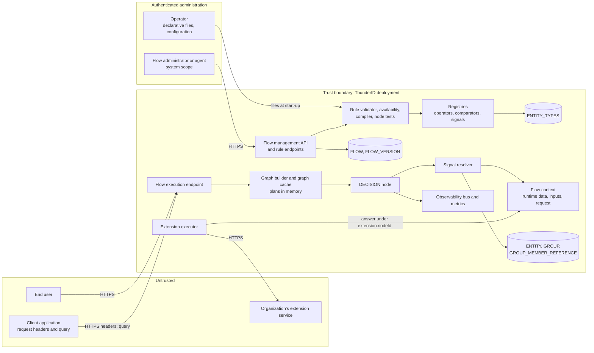
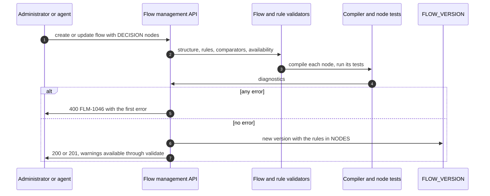
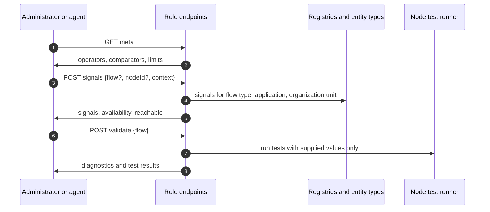
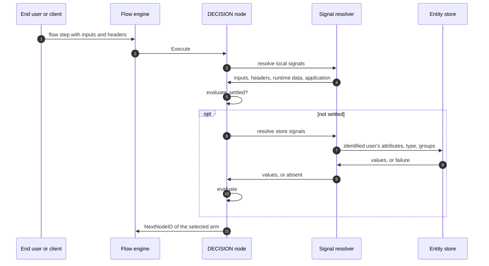
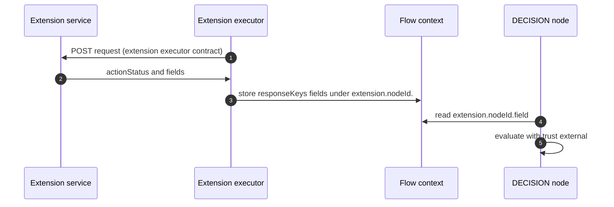
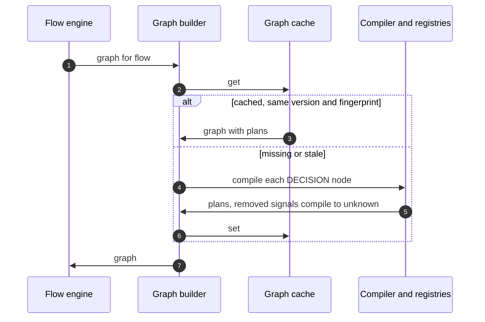
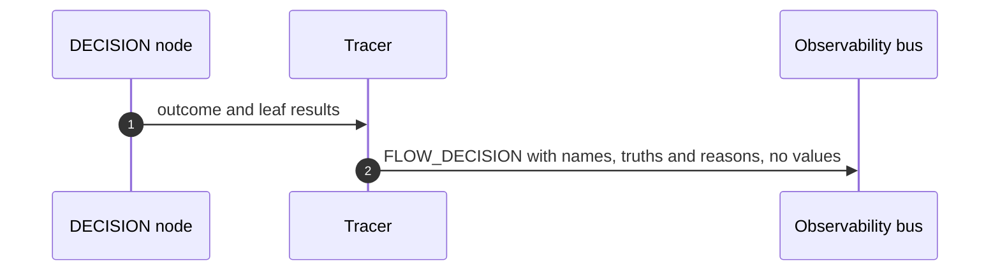

# Conditional Flow Execution Threat Model

This model covers conditional flow execution in ThunderID: the `DECISION` node and its rules, the save-time validation, availability analysis and compilation of those rules, the `meta`, `signals` and `validate` rule endpoints, the evaluation of a decision while a flow runs, the resolution of the signals a rule reads, and the decision event.

## Overview

A decision node routes a flow to one of several next nodes by evaluating ordered rules over named values called signals. Rules are written by administrators through the flow management API, the Console, declarative resources or agents, and are stored inside the flow definition. When a flow reaches the node, the engine reads the signals the rules need from the flow context, the request, the entity store and the answers of earlier extension steps, evaluates the rules with three-valued logic, and follows the arm they select.

The security-relevant shift is that routing becomes data-driven. Today a flow's path is fixed by its graph, apart from the fail-open skip guard. With this feature, the path a user takes, and so the checks they are put through, depends on values that come from different parties with different trust: the directory, the platform, an external service, and the end user or their client. Most of this model follows from that. A rule must not let a value the user controls stand in for one the directory vouches for, must not treat missing data as a pass, and must not reveal through routing what it reads.

Cross-cutting concerns covered elsewhere: the authentication and authorization of the flow management API, including the organization unit that owns a flow; the flow execution engine and its endpoint; the extension executor and HTTP endpoint connections, including what an extension step sends out and how its answer is stored; the entity store and entity types; the observability event bus. These are trust inputs here, not re-analysed.

## Scope

This model covers:

- Authoring and saving decision rules through the flow management API, the Console and declarative resources, including the structural, rule, comparator and availability checks and the node tests run at save.
- `GET /flows/rules/meta`, `POST /flows/rules/signals` and `POST /flows/rules/validate`.
- Compilation of rules into plans, their caching with the flow graph, and their invalidation when registries or user type schemas change.
- Evaluation of a decision node during a flow execution: staged signal resolution, three-valued evaluation, the `FIRST` hit policy and the `default` and `unknown` arms.
- The signal registry: built-in, schema, input, request and extension output signals, their trust levels and reserved prefixes.
- The `FLOW_DECISION` event and the decision metrics.

Out of scope (see the referenced companion models or the owning area):

- Authentication of callers of the flow management API, and the permission and organization unit checks on reading and changing a flow. Owned by the flow management area. This model takes "the caller is authorized to change this flow" as a trust input and analyses what an authorized author can then cause.
- The flow execution endpoint, flow state persistence and resumption. Owned by the flow execution area.
- What an extension step sends to an organization's service, the service's authentication, and the storage of its answer under `extension.<nodeId>.`. Owned by the extension executor specification. This model analyses only the use of a stored answer as a signal.
- The skip guard (`condition`) on other node types. It is unchanged by this feature and keeps its fail-open behaviour.
- Storage, access control and retention of observability events. Owned by the observability area and the operator.
- The DSL, What-If simulation, the derivation node, arm actions and the `ipInRange` operator. Future specifications, each with its own model.

## Architecture

Three things cross into the decision path from outside the deployment, each at a different trust level. The end user's inputs and the client's request headers and query parameters arrive through the flow execution endpoint and are fully controlled by the user or their client. An extension service's answer arrives through the extension executor and is controlled by whoever operates or compromises that service. Directory data and platform state are inside the boundary. The signal registry gives each value one name and one trust level, so a rule always says which of these it relies on.

Rules themselves cross only through authenticated administration: the management API with the `system` scope, or declarative files the operator places. Rules are data. Nothing in a rule is executed as code, templated or passed to an interpreter.

### Components

| Component | Task |
| --- | --- |
| Flow management API | Creates and updates flows, including decision nodes. Refuses a flow whose decision nodes have errors, with `FLM-1046` |
| Rule endpoints | `meta` describes operators, comparators and limits. `signals` lists the signals for a context or a node. `validate` returns every diagnostic and runs node tests. None of them saves anything or reads user data |
| Rule validator | Parses the rule IR with unknown fields refused, checks structure, operators, operands, limits and comparators, and collects every diagnostic |
| Availability analysis | Computes, per decision node, the signals that exist on every path, some paths or none, from the flow graph, executor outputs, prompt inputs and extension `responseKeys` |
| Compiler | Turns validated rules into an immutable plan of closures. Never reorders rules |
| Node test runner | Runs a node's test scenarios against its plan using only the values the test supplies |
| Registries | Operators, comparators and signals. Built at start-up and immutable; schema signals are generated from user type schemas, skipping credential attributes |
| Graph builder and graph cache | Compiles plans when a flow's graph is built and caches them per server. Rebuilds when the flow's active version or the registry fingerprint changes |
| Decision node | Resolves signals in stages, evaluates, follows the selected arm. Writes nothing and cannot fail; every problem becomes unknown |
| Signal resolver | Reads local signals from the flow context and the identified user's attributes, type and groups from the entity store, bounded by the request deadline. A failed source leaves its signals absent |
| Tracer | Publishes one `FLOW_DECISION` event per evaluation, with signal names, truths and reason codes, and no values |

### Actors

#### Actors

| Actor | Description | Roles or permissions |
| --- | --- | --- |
| Flow administrator | Writes and changes decision rules through the Console or the management API | `system` scope, and the organization unit check of the flow management API |
| Agent | An automated client that writes rules through the API | The same as the flow administrator it acts for |
| Operator | Deploys ThunderID, places declarative flow files, sets the decision limits, and owns event retention | Deployment configuration |
| End user | Runs a flow and supplies inputs at prompts | None over this feature; supplies `input.*` values |
| Client application | Starts a flow and sends requests on the user's behalf | None over this feature; supplies `request.*` values |
| Extension service | An organization's service called by an extension step | Supplies `extension.<nodeId>.*` values through the extension executor |
| Event consumer | Reads decision events and metrics | Whatever the operator grants on the observability sink |

#### Entitlement matrix

| Actor | Write or change rules | Discover signals and validate | Supply signal values at run time | Choose the arm on missing data | Read decision events |
| --- | --- | --- | --- | --- | --- |
| Flow administrator | [Yes], for flows its organization unit may change | [Yes] | [No] | [Yes], by setting the `unknown` arm | [No], unless also an event consumer |
| Agent | [Yes], as the administrator it acts for | [Yes] | [No] | [Yes] | [No] |
| Operator | [Yes], through declarative files | [No] | [No] | [No] | [Yes] |
| End user | [No] | [No] | [Yes], `input.*` only | [No] | [No] |
| Client application | [No] | [No] | [Yes], `request.*` only | [No] | [No] |
| Extension service | [No] | [No] | [Yes], its own `extension.<nodeId>.*` only | [No] | [No] |
| Event consumer | [No] | [No] | [No] | [No] | [Yes] |

No actor outside the deployment can supply a `user.*`, `session.*`, `application.*` or `flow.*` value.

### External Dependencies (not owned)

| Dependency | Description (usage, purpose, authentication, authorization, security) |
| --- | --- |
| Flow management API authorization | OAuth2 with the `system` scope, and the organization unit ownership check on flow reads and changes. Owned by the flow management area. The rule endpoints use the same authorization |
| Flow execution engine | Runs the decision node through `NodeInterface` and follows `NextNodeID`. Owned by the flow execution area; unchanged by this feature |
| Entity provider and entity store | Supplies the identified user's attributes, type and groups. The resolver reads only the user the flow has identified. Owned by the entity area |
| Entity type service | Supplies user type schemas, including the `credential` marking that keeps an attribute out of the registry. Owned by the entity type area |
| Extension executor | Calls an organization's service through an HTTP endpoint connection and stores its answer under `extension.<nodeId>.`, refusing reserved keys. Owned by the extension executor specification |
| Observability bus | Delivers `FLOW_DECISION` events to the sink the operator configured. Retention and access control are the operator's |

## Threats and mitigations

### Out-of-scope interactions and risks

- Bypass of the flow management API's authentication or organization unit check. Owned by the flow management area. An actor who can change a flow can already reroute it without decision nodes, by editing its edges.
- Compromise of the operator's declarative files or deployment configuration. An operator who can change those can change any flow.
- What an extension step sends to its service, the service's authentication and TLS, and the reserved-key check on its answer. Owned by the extension executor specification.
- The fail-open behaviour of the existing skip guard on other node types. Unchanged here; recorded as a residual because authors may mistake it for a decision.
- Compromise of the entity store or tampering with user attributes through other APIs. A rule that reads a tampered attribute behaves as the data says.
- Access control on the observability sink. Owned by the operator.

### Interactions

#### 01: Authoring and saving decision rules

**Description**

A flow administrator or agent creates or updates a flow through the management API or the Console, or the operator supplies a declarative flow file. Every decision node is parsed with unknown fields refused, checked for structure and limits, checked against the operator, comparator and signal registries, checked for signal availability on the paths into the node, compiled, and tested with its own test scenarios. Any error refuses the save with `400 FLM-1046`. Warnings are returned and the save goes ahead. The accepted flow is stored as a new `FLOW_VERSION` row.

**Assets involved**

| Initiator | Intermediate | Target |
| --- | --- | --- |
| Flow administrator, agent or operator | Flow management API, rule validator, availability analysis, compiler, node test runner | `FLOW_VERSION.NODES` |

**Data flow**

**Security considerations**

| Area | Response | Comments |
| --- | --- | --- |
| Data confidentiality | [C-Medium] | Rules describe how security decisions are made, for example which groups skip a step. They hold no secrets or personal data |
| Communication medium | [M-NT], [M-DB], [M-FS] | API over the network, storage in the configuration database, declarative files on the file system |
| Transport security | [TLS] | On the management API listener |
| Authentication | OAuth2 bearer token for the management API; file system access for declarative files | |
| Accessibility | [Restricted] | |
| Authorization and Access Control | `system` scope and the organization unit check of the flow management API | |

**Threat assessment**

| ID | Category | Threat | Materializable | Mitigation / comment |
| --- | --- | --- | --- | --- |
| 1 | [Elevation of Privilege] | An author writes a rule that treats missing data as a pass, for example `not (user.groups eq blocked)`, so that when the directory is unreachable a blocked user is let through | [No] | Every condition is three-valued. A missing value or failed source makes the leaf unknown, `not unknown` is unknown, and an unknown rule sends the flow to the `unknown` arm, which every decision node must declare. No rule can turn missing data into true |
| 2 | [Elevation of Privilege] | An author places a broad rule above a stricter one, so the stricter rule never decides and a group meant to need MFA skips it | [No] | `W_SHADOWED_RULE` flags rules an earlier rule always pre-empts. Node tests express the intended outcomes and refuse the save when a reorder changes one. An unknown earlier rule blocks later rules, so a skip rule cannot win while a stricter rule above it is undecided. The residual is a rule set that is wrong but consistent with its tests, which is an authoring error no tooling can fully detect |
| 3 | [Security Risk] | A rule names a raw runtime-data key, such as `attemptCount` or a key an extension or executor writes, whose meaning or producer the author did not intend, and routes on a value another step controls | [No] | Rules can name declared signals only. Raw runtime-data keys are unreachable, and an extension answer is reachable only as `extension.<nodeId>.<field>` when the field is in that step's `responseKeys` |
| 4 | [Security Risk] | Rule content is executed, templated or interpreted, giving an author or a crafted declarative file code execution in the server | [No] | Rules are a closed JSON structure with unknown fields refused. Operators are a fixed registry; values are literals or signal names. There is no expression language, no placeholder resolution and no regular expression in phase 1. Recognisers are hand-written scanners |
| 5 | [Denial of Service] | A very large or deeply nested rule set makes save, availability analysis or compilation consume excessive CPU or memory | [No] | Rules per node, nesting depth, leaves per node and list size are capped (32, 6, 128 and 1000 by default; hard caps 64, 8, 256 and 1000). Availability analysis is linear in nodes and edges times signals divided by 64. Compilation is linear in the rule tree. The target is 10 ms per node |
| 6 | [Denial of Service] | A decision node carries thousands of test scenarios, each compiled and evaluated on every save and validate call | [No] | Tests per node are capped by `flow.decision.max_tests_per_node`, 32 by default and at most 64. Each test is a single evaluation of an already compiled plan with no I/O |
| 7 | [Tampering] | A save is accepted with a rule that the server cannot evaluate correctly, for example an operator or grammar version from a newer release, and the rule is silently skipped at run time | [No] | Unknown operators, signals, fields and grammar versions refuse the save and refuse to load. No part of a rule is ever skipped |
| 8 | [Repudiation] | A rule is changed and changed back, and the audit record says the flow was updated without showing which rule changed, so the window in which a check was weakened cannot be reconstructed | [Yes] | Every change creates a new flow version, kept up to `max_version_history`, so earlier rules can be retrieved while they remain in history. Flow update audit records do not carry an old-to-new difference, a pre-existing gap in flow management. Recorded as a residual with checklist item 14 |
| 9 | [Process Risk] | Rule changes are security changes but are saved by a single administrator with no review | [Yes] | No approval workflow exists for flows in phase 1. Node tests, warnings and version history reduce the risk. Recorded as a residual; review and approval of flow changes is a separate feature |

#### 02: Discovering signals and validating drafts

**Description**

The Console or an agent calls `GET /flows/rules/meta` for the rule language, `POST /flows/rules/signals` for the signals of a context or of one node of a draft flow, and `POST /flows/rules/validate` for every diagnostic and the node test results of a draft. None of these saves anything. `signals` reads the registries and, for schema signals, the user types of the organization unit in the context. `validate` runs node tests on the values each test supplies and reads no user data.

**Assets involved**

| Initiator | Intermediate | Target |
| --- | --- | --- |
| Flow administrator or agent | Rule endpoints, registries, availability analysis, node test runner | `ENTITY_TYPES` (read), registries (read) |

**Data flow**

**Security considerations**

| Area | Response | Comments |
| --- | --- | --- |
| Data confidentiality | [C-Medium] | Signal names reveal user type attribute names and the shape of the deployment's flows. No attribute values are returned |
| Communication medium | [M-NT] | |
| Transport security | [TLS] | |
| Authentication | OAuth2 bearer token | |
| Accessibility | [Restricted] | Not under the public `/flow/meta` or `/flow/execute` paths |
| Authorization and Access Control | `system` scope; the organization unit check of the flow management API applies to `context.ouId` | |

**Threat assessment**

| ID | Category | Threat | Materializable | Mitigation / comment |
| --- | --- | --- | --- | --- |
| 1 | [Information Disclosure] | An unauthenticated caller lists signals and learns user type attribute names, application names and how security decisions are structured | [No] | The rule endpoints require the `system` scope, as every flow management route does, and are deliberately not under the public `/flow/meta` path, which serves the login UI without authentication |
| 2 | [Information Disclosure] | An administrator of one organization unit passes another unit's ID as `context.ouId` and learns the attribute names of that unit's user types | [No] | `signals` and `validate` apply the flow management API's organization unit check to `context.ouId` and to the draft's `ouId`. A caller resolves schema signals only for a unit whose flows it may read; otherwise the call returns `403` and lists nothing (AC9.6). Values are never returned in any case |
| 3 | [Information Disclosure] | `validate` is used as an oracle to learn a real user's attributes or group memberships by running tests against live data | [No] | Node tests use only the values each test supplies. Signals not supplied are absent. No test reads the entity store, sessions, runtime data or any external service |
| 4 | [Denial of Service] | Repeated `validate` calls with maximum-size drafts consume CPU on the management plane | [No] | Each call is bounded by the rule limits and the request size, does no I/O beyond reading registries, and requires the `system` scope, so the caller is an authenticated administrator. There is no request-rate limit on management routes; the same exposure exists for flow create and update today |
| 5 | [Information Disclosure] | A diagnostic's `suggestion` or a test trace leaks data beyond what the caller sent | [No] | Suggestions are signal names from the registry the caller may already list. Test traces carry only values the test supplied |

#### 03: Evaluating a decision during a flow

**Description**

A user runs a flow through the flow execution endpoint. When the flow reaches a decision node, the node takes its plan from the cached graph, resolves the plan's signals in stages (local, then store), evaluates the rules in order with three-valued logic, and returns the selected arm's next node. Signals not yet resolved are unknown; the node stops as soon as the outcome cannot change. A source that fails leaves its signals absent. The node writes nothing and cannot fail the flow.

**Assets involved**

| Initiator | Intermediate | Target |
| --- | --- | --- |
| End user and client application | Flow execution endpoint, flow engine, decision node, signal resolver, evaluator | The next node of the flow |

**Data flow**

**Security considerations**

| Area | Response | Comments |
| --- | --- | --- |
| Data confidentiality | [C-High] | Evaluation reads user attributes, group memberships and values the user entered |
| Communication medium | [M-IN], [M-DB] | In process, plus entity store reads |
| Transport security | [TLS] | The flow execution endpoint; store connections as configured by the operator |
| Authentication | None for the end user at this point beyond the flow execution itself; the flow decides when the user is authenticated | |
| Accessibility | [Public] | The flow execution endpoint is public |
| Authorization and Access Control | The resolver reads only the user the flow has identified; no rule can address another entity | |

**Threat assessment**

| ID | Category | Threat | Materializable | Mitigation / comment |
| --- | --- | --- | --- | --- |
| 1 | [Spoofing] | An end user enters a value at a prompt, for example an email at a corporate domain, and a rule treats it as a verified attribute, routing the user past a check meant for other users | [No] | Values the user enters are `input.*` signals with trust `subject`, never `user.*`. A rule whose condition depends only on `subject` signals raises `W_SUBJECT_TRUST` at save. A stored, verified attribute is reachable only as `user.*` from the entity store |
| 2 | [Spoofing] | A client sends a header such as `X-Forwarded-For` or a custom network-zone header, and a rule routes on it as if it were established by the platform | [No] | Request headers and query parameters are `request.*` signals with trust `subject`, and the same `W_SUBJECT_TRUST` warning applies. No built-in signal is derived from a header. The client IP address is not a signal in phase 1; it requires trusted-proxy handling in a future specification |
| 3 | [Elevation of Privilege] | A rule uses `user.*` attributes after a step that identifies the user from a typed username but before any step that authenticates them, so an attacker who types a privileged user's username is routed as that user, for example past a step-up meant for others | [No] | Executors declare whether they identify a user (`user.id`) or authenticate one (`user.id` and `user.authenticated`). A rule that reads `user.ouId`, `user.type`, `user.groups` or a schema signal at a node where `user.authenticated` is not available on every incoming path raises `W_UNAUTHENTICATED_USER` (AC6.7). It is a warning, because choosing an authentication method by user type before authentication is legitimate. An author who accepts the warning still has every later authentication step on each path they kept; the residual is recorded below |
| 4 | [Information Disclosure] | Routing after identification reveals attributes of an unauthenticated account: an attacker types usernames and observes which prompt follows, learning which accounts are administrators or members of a group | [No] | `W_UNAUTHENTICATED_USER` flags every rule that routes on directory signals before authentication, which is where this disclosure comes from. The pre-existing identifier-first pattern already reveals whether an account exists through the next prompt; a rule that accepts the warning can widen that to an attribute. The guide advises routing on directory signals only after authentication. Recorded as a residual |
| 5 | [Elevation of Privilege] | An attacker makes the entity store fail or time out, for example by load, so that a rule requiring a group cannot be evaluated and the flow takes a more permissive path | [No] | A failed source makes the leaf unknown and the node takes the `unknown` arm, which the author chooses explicitly. A failed source can never make a rule true or false. Guidance and Console templates pre-select the strictest arm for `unknown` |
| 6 | [Tampering] | Values of different kinds are compared under the wrong reading, for example `"0123"` against `123` as numbers, or `"10"` and `"9"` as text, so a rule matches when it should not | [No] | Comparators decide how values are read. Text is never ordered. A comparison no comparator can make is unknown, never false. Signals that look numeric but are not, such as postal codes, declare `text`. The inference order is frozen, so a comparator added later cannot change how an existing rule reads its values |
| 7 | [Tampering] | A case-insensitive or substring text check is bypassed with crafted input, for example `alice@example.com.evil.test` passing `contains "@example.com"`, or a lookalike character passing `eq` | [No] | Text checks on `subject` values carry the `W_SUBJECT_TRUST` warning. Values are compared as given, with simple case folding for `ci` and no normalisation, so a lookalike does not equal the original. A domain check belongs on a verified `user.*` attribute with `endsWith`. The guide explains the difference between `contains` and `endsWith` for domains |
| 8 | [Denial of Service] | An attacker drives many flow executions so that every decision node reads the entity store, amplifying load on it | [No] | One decision reads the store at most once, in one batch, and only when local signals do not settle the outcome. Plans are compiled once per version and evaluation allocates nothing in steady state. Request volume itself is owned by the flow execution endpoint |
| 9 | [Denial of Service] | Evaluation is made slow by input size, for example a very long header or a user with thousands of groups | [No] | Each leaf compares a value with a literal or a hash set built at compile time, so cost is linear in the number of values the signal holds. Header and input sizes are bounded by the HTTP server's limits; group count is bounded by the directory. No regular expression is evaluated, so there is no catastrophic backtracking |
| 10 | [Information Disclosure] | Timing reveals what a rule read, for example whether the entity store was consulted | [No] | Whether the store stage runs depends only on local values, which the user or client already supplied. The difference reveals nothing the requester did not send |
| 11 | [Security Risk] | The decision node fails or panics on unexpected data and the flow engine treats the failure as a pass or falls through to another node | [No] | The node cannot fail: every problem is unknown and routes through the `unknown` arm. Leaf evaluation is pure and has no error path. Fuzzing against the reference evaluator covers malformed values |

#### 04: Using values from extension services

**Description**

An extension step calls an organization's service and stores the fields named in its `responseKeys` under `extension.<nodeId>.<field>`. A later decision node reads such a field as a `FLOW` signal with trust `external`. The signal exists only on the step's `onSuccess` path. The step's `outputs` property can declare a display name, a comparator and a sensitivity for each field.

**Assets involved**

| Initiator | Intermediate | Target |
| --- | --- | --- |
| Extension service | Extension executor, flow context | Decision node |

**Data flow**

**Security considerations**

| Area | Response | Comments |
| --- | --- | --- |
| Data confidentiality | [C-Medium] to [C-High] | Depends on the service; for example a computed age is personal data, declared with sensitivity `pii` |
| Communication medium | [M-NT], [M-IN] | |
| Transport security | [TLS] | Required by the HTTP endpoint connection when it carries authentication |
| Authentication | The connection's authentication, owned by the extension executor | |
| Accessibility | [Internal] | |
| Authorization and Access Control | Only fields in `responseKeys` are stored and usable | |

**Threat assessment**

| ID | Category | Threat | Materializable | Mitigation / comment |
| --- | --- | --- | --- | --- |
| 1 | [Spoofing] | A compromised or malicious extension service returns a field named like a directory attribute, such as `user.age` or `groups`, and a rule treats it as directory data | [No] | The extension executor stores answers only under `extension.<nodeId>.` and refuses reserved keys. The registry names the signal `extension.<nodeId>.<field>` with trust `external`. No extension answer can become a `user.*` signal |
| 2 | [Tampering] | A compromised service returns values that steer routing, for example an age that skips an age check | [Yes] | By design, a rule that routes on an external value trusts that service for that decision. The trust is visible in the signal name and its `external` trust, and the author chooses it. This is the residual of relying on any external decision source. A service's integrity is owned by its operator and the extension executor's connection controls |
| 3 | [Elevation of Privilege] | A rule uses an extension field on a path where the step failed, was skipped or answered `INCOMPLETE`, and reads a stale value from an earlier execution | [No] | The signal exists only on the step's `onSuccess` path. On other paths the availability analysis reports it as absent, and the extension executor clears the step's namespace before each call, so a value from an earlier answer is not read |
| 4 | [Security Risk] | A step stores every field its service returns, and a rule names a field the service may or may not send, so the rule's meaning depends on the service's response shape | [No] | A step with no `responseKeys` produces no signals; rules can use only fields explicitly allow-listed and, optionally, typed in `outputs`. A field missing from an answer is absent and the rule is unknown |
| 5 | [Privacy Risk] | Personal data returned by a service, such as an age, is exposed through decision events or logs | [No] | The decision event carries signal names and reason codes, never values. The flow context stores the answer as the extension executor already does, and it expires with the flow |

#### 05: Compiling, caching and invalidating plans

**Description**

The graph builder compiles each decision node's plan when it builds a flow's graph and caches the graph per server. The cache entry is rebuilt when the flow's active version changes or when the registry fingerprint changes: a hash of the built-in registries and of each user type schema the flow's plans use. A leaf whose signal no longer exists, for example because a schema attribute was removed, compiles to unknown and is reported on the next save.

**Assets involved**

| Initiator | Intermediate | Target |
| --- | --- | --- |
| Flow engine | Graph builder, compiler, registries | Graph cache (in memory) |

**Data flow**

**Security considerations**

| Area | Response | Comments |
| --- | --- | --- |
| Data confidentiality | [C-Low] | Plans hold rule structure and literals |
| Communication medium | [M-IN] | |
| Transport security | [Not Encrypted] | In process |
| Authentication | N/A | |
| Accessibility | [Internal] | |
| Authorization and Access Control | N/A | |

**Threat assessment**

| ID | Category | Threat | Materializable | Mitigation / comment |
| --- | --- | --- | --- | --- |
| 1 | [Tampering] | A server keeps evaluating a stale plan after the flow or a user type schema changed, so a tightened rule is not applied | [No] | The graph cache compares the flow's active version, read from the shared flow store, and the registry fingerprint before reuse, so every server rebuilds on its next read |
| 2 | [Elevation of Privilege] | A schema attribute that a rule depends on is removed, and the rule silently starts evaluating differently | [No] | The leaf compiles to unknown, so the rule cannot be true and the `unknown` arm decides. The event carries `stale: true` and a warning is logged. The next save reports `E_UNKNOWN_SIGNAL` |
| 3 | [Operational Risk] | Removing a schema attribute sends every affected flow through its `unknown` arm until the flows are fixed, denying access to legitimate users if that arm denies | [Yes] | The outcome is fail-closed and visible through the stale flag and the rising unknown rate. Blocking the removal of an attribute that a rule uses, through the dependency registry, is an open question in the specification. Recorded as a residual |
| 4 | [Denial of Service] | A frequently edited user type schema forces repeated recompilation of every flow | [No] | The fingerprint is per user type, so only flows whose plans use that user type recompile, once per server, on next use |
| 5 | [Operational Risk] | A user paused at a prompt resumes after the flow was updated and meets rules or arms that did not exist when they started | [Yes] | Pre-existing behaviour: the flow context stores the flow ID, not the version. With decision nodes the effect can include different routing. Whether to pin the version is an open question in the specification. Recorded as a residual |

#### 06: Publishing decision events and metrics

**Description**

Every evaluation publishes one `FLOW_DECISION` event on the observability bus with the execution, flow, version and node identifiers, the selected arm and rule, each rule's truth, and for each evaluated leaf its path, signal name, truth, reason code and comparator. The event carries no signal values. Metrics record decisions by arm, the unknown and default rates, incomparable leaves, stages used and latency.

**Assets involved**

| Initiator | Intermediate | Target |
| --- | --- | --- |
| Decision node | Tracer | Observability sink, metrics |

**Data flow**

**Security considerations**

| Area | Response | Comments |
| --- | --- | --- |
| Data confidentiality | [C-Medium] | Truths about a user, such as that a group check matched, are personal data by association with the execution ID |
| Communication medium | [M-IN] | Then whatever transport the operator's sink uses |
| Transport security | As configured by the operator | |
| Authentication | N/A | |
| Accessibility | [Restricted] | |
| Authorization and Access Control | Access to the sink is the operator's | |

**Threat assessment**

| ID | Category | Threat | Materializable | Mitigation / comment |
| --- | --- | --- | --- | --- |
| 1 | [Repudiation] | A user is routed past a check and nothing records why, so an incident responder cannot tell which rule decided or whether data was missing | [No] | One event per evaluation records the deciding rule, the arm, every rule's truth and each leaf's reason, including `UNRESOLVED` and `ABSENT` |
| 2 | [Information Disclosure] | Signal values, such as an email, an age or group names, reach the log store | [No] | The event carries signal names, truths and reason codes, never values. Node test traces returned by `validate` contain only the values the test supplied |
| 3 | [Privacy Risk] | The event links an execution to facts about the user, for example that a group check matched, for the life of the operator's retention | [No] | The facts are minimal: a truth and a reason per leaf, needed to explain the decision. Retention and access are the operator's, as for every event on the bus |
| 4 | [Operational Risk] | A source fails silently and many users are routed through the `unknown` arm without anyone noticing | [No] | The unknown rate per node is a metric, and each event shows `UNRESOLVED` leaves |

## Security Review Checklist

A review aid that complements the threat model. Guidance follows the [OWASP Top 10 Proactive Controls](https://top10proactive.owasp.org/).

### Security considerations

| # | Consideration | State | Comments |
| --- | --- | --- | --- |
| 1 | Are all inputs and outputs validated (syntactic and semantic)? | [Yes] | Rules are parsed against a closed schema with unknown fields refused, and checked semantically against the registries, the flow graph and the signal availability at each node. At run time every value is classified by comparators before use, and an unreadable value is unknown |
| 2 | Are rate limits in place where necessary? | [Partial] | The repository has no request-rate limiting framework. Work per request is bounded structurally: rule limits, one store batch per decision, no I/O in node tests. Flow execution volume is owned by the flow execution area |
| 3 | Are permissions, roles, and entitlements defined on the principle of least privilege and business need? | [Yes] | Rule authoring and the rule endpoints use the flow management API's `system` scope and organization unit check. The resolver reads only the identified user. End users, clients and extension services can supply values only under their own prefixes and trust levels |
| 4 | Are authentication and authorization validated at both the UI and API layers, front end and back end, before granting access to resources? | [Yes] | The Console writes through the management API, and validation runs server side on every save and declarative load. Console-side checks are for feedback only |
| 5 | Are proper isolations in place between components to ensure least-privilege access and reduce the blast radius against lateral movement? | [Yes] | `internal/flow/rules` imports no executor, store or network package and reads data only through the resolver. The decision node writes nothing. Extension answers stay in their own namespace |
| 6 | Have any default credentials been changed, and are default superuser or root accounts not in use (when using third-party components)? | [N/A] | No credentials or third-party components are introduced |
| 7 | Has the implementation followed best-practice guidelines (OWASP, Kubernetes, vendor, or technology provider)? | [Yes] | Fail-closed handling of missing data, allow-listed inputs (declared signals only), no dynamic code evaluation, and bounded resource use follow the OWASP Proactive Controls on input validation and secure defaults |
| 8 | Are secrets, credentials, and internal-only material kept out of the public source tree and its git history? | [Yes] | The feature introduces no secret. Credential attributes are excluded from the registry |
| 9 | Was a security-focused code review conducted for this change, and have the findings been addressed? | [Partial] | Applies to the implementation pull requests. Points to verify: unknown fields refused, the `unknown` arm mandatory, unknown never coerced to false, credential attributes excluded, `subject` trust on `input.*` and `request.*`, and no values in the event |
| 10 | Is Static Analysis (SAST) or IaC scanning conducted, and are findings addressed? | [Yes] | `gosec` runs as part of the backend golangci-lint configuration, which `make pr_checks` gates on |
| 11 | Is Software Composition Analysis (SCA) conducted or integrated into the repository, and are findings addressed (for example FOSSA, Trivy)? | [Partial] | Go dependency changes are validated on every pull request that touches `go.mod`. There is no continuous scan of the full dependency set. This feature adds no dependency |
| 12 | Is Dynamic (DAST) or API scanning conducted on a non-production setup, and are findings addressed? | [No] | No DAST pipeline exists. The evaluator is covered instead by a reference evaluator, a conformance corpus, fuzzing and property tests |
| 13 | Are audit logs generated in a standardized format for critical functionality, and available to authorized users to trace critical events and aid incident response? Note the retention period in Comments. | [Yes] | One `FLOW_DECISION` event per evaluation on the existing observability bus. Flow changes are audited by flow management. Retention is the operator's |
| 14 | Do audit logs for critical configuration changes record the difference between the old and new versions? | [No] | Flow updates are audited without an old-to-new difference. Earlier rules remain retrievable from version history while they are retained. Pre-existing gap in flow management, recorded as a residual |
| 15 | Are data in transit and at rest encrypted? | [Partial] | The management API and flow execution endpoint use TLS. Rules are stored in the configuration database like the rest of the flow, without additional encryption; they contain no secrets |
| 16 | Are sensitive values such as credentials and keys stored in a secret store or vault? | [N/A] | The feature handles no credentials or keys |
| 17 | Is personal, sensitive, or confidential data kept out of logs? | [Yes] | The decision event carries no signal values. Node test results return only values the test supplied |
| 18 | Have users been given clear instructions for secure usage? | [Partial] | The flow and decision node guides must explain the `unknown` arm, the difference between `input.*` and `user.*`, why headers are untrusted, routing on directory data only after authentication, and `endsWith` rather than `contains` for domain checks. They are part of the implementation deliverable and do not exist yet |

### Business impact and resilience

For an open-source component, most of these are shared with the operator who deploys it.

| # | Consideration | State | Comments |
| --- | --- | --- | --- |
| 1 | Has a business impact analysis been done to identify resilience requirements (maximum tolerable downtime, uptime, RPO, RTO)? | [N/A] | Owned by the deployer. A decision node adds no new runtime dependency: an unavailable entity store makes affected rules unknown, and the flow continues through the `unknown` arm |

Resilience details for this area:

- High availability: plans are compiled per server from the shared flow store, with no coordination between replicas.
- Disaster recovery: rules are part of the flow definition and are backed up with the configuration database. Plans and registries are rebuilt on start-up.
- Backups and retention: no new table. Flow version history is bounded by `max_version_history`.
- Health checks: none specific. A rising unknown rate or stale decisions are the operational signals.
- User banners: not applicable.

### Dependency and component health

| # | Consideration | State | Comments |
| --- | --- | --- | --- |
| 1 | Are dependencies, base images, and runtimes monitored for known vulnerabilities and kept current (for example automated dependency scanning), and are findings addressed? | [Partial] | As checklist item 11. The feature uses only the standard library |
| 2 | Are any End-of-Life or End-of-Service components in use? | [No] | |
| 3 | Is hardening guidance published for operators who deploy the project (optional)? | [No] | The decision limits are configuration with safe defaults and hard caps. Guidance on keeping them at the defaults belongs in the configuration reference |

### Privacy considerations

The feature reads personal data to evaluate rules: user attributes, group memberships, values the user entered and values extension services return. It stores none of it.

| # | Consideration | State | Comments |
| --- | --- | --- | --- |
| 1 | Is the purpose and legal basis for processing personal data clearly defined? | [Yes] | The purpose is to choose the authentication or registration path that applies to the user, as configured by the deployer. The controller is the deployer |
| 2 | Are the collection, storage, processing, sharing, archival, and disposal of personal data aligned with the data minimization principle? | [Yes] | Only the signals a plan uses are resolved, cheapest first, and resolution stops once the outcome is settled. Nothing is written. Credential attributes never become signals |
| 3 | Is personal data stored securely? | [N/A] | The feature stores no personal data. Extension answers and inputs live in the existing flow context |
| 4 | Are privacy notices updated to reflect any new processing or changes to purpose and legal basis? | [N/A] | Owned by the deployer |
| 5 | Is access to personal data granted on a need-to-know basis? | [Yes] | The resolver reads only the identified user's data. Administrators see signal names, never values. Events carry no values |
| 6 | Are data retention requirements considered? | [Yes] | Values are held in an evaluation frame for the duration of one decision and then discarded. Event retention is the operator's |
| 7 | Is there a process to dispose of personal data on request in a timely manner while meeting retention requirements? | [N/A] | Nothing new is retained |
| 8 | Are records of personal-data processing maintained in the project's data inventory or records of processing? | [N/A] | Owned by the deployer |

## Residual risks (open items)

- **Directory signals before authentication, where the author accepts the warning.** `W_UNAUTHENTICATED_USER` flags every rule that reads the identified account's directory signals before the user is authenticated. Selecting an authentication method by user type is a legitimate reason to accept it. An author who accepts it for a rule that skips a step, rather than selects one, weakens the flow; the remaining authentication steps on each path bound the impact.
- **Rules that trust external services.** A rule that routes on an extension answer trusts that service for the decision. Visible through the `extension.` prefix and `external` trust, and owned by the service's operator.
- **Rule logic errors.** A rule set that is wrong but consistent with its own tests weakens a flow. Warnings, tests and version history reduce this; review and approval of flow changes is a separate feature.
- **Flow changes are audited without a difference.** A rule weakened and restored leaves no reconstructable interval beyond version history. Pre-existing in flow management.
- **Executions resume on the active version.** A user paused at a prompt resumes on an updated flow and may meet new rules. Pre-existing; an open question in the specification.
- **Removing a schema attribute that rules use** sends affected flows through their `unknown` arm until fixed. Fail-closed and visible, but disruptive. Blocking the removal is an open question in the specification.
- **The skip guard stays fail-open.** Authors may mistake `condition` for a decision. It is unchanged; the guides should point authors to decision nodes for any security decision.
- **Routing reveals account existence** in identifier-first flows, as it does today. Decision nodes can widen what routing reveals; guidance is to route on directory data only after authentication.

## Appendix

- References: [Conditional flow execution specification](spec.md), [Extension executor specification](../extension-executor/spec.md), [OWASP Top 10 Proactive Controls](https://top10proactive.owasp.org/), [OWASP Authentication Cheat Sheet](https://cheatsheetseries.owasp.org/cheatsheets/Authentication_Cheat_Sheet.html).
- Design discussion: [Conditional flow execution with a declarative rule engine](https://github.com/thunder-id/thunderid/discussions/6298), and the feature issue [#5145](https://github.com/thunder-id/thunderid/issues/5145).

## Change log

| Version | Date | Change |
|---|---|---|
| 0.1 | 2026-11-05 | Initial threat model, from design discussion #6298 and specification version 0.2, which adds the controls for interaction 01 threat 6, interaction 02 threat 2 and interaction 03 threats 3 and 4. |
